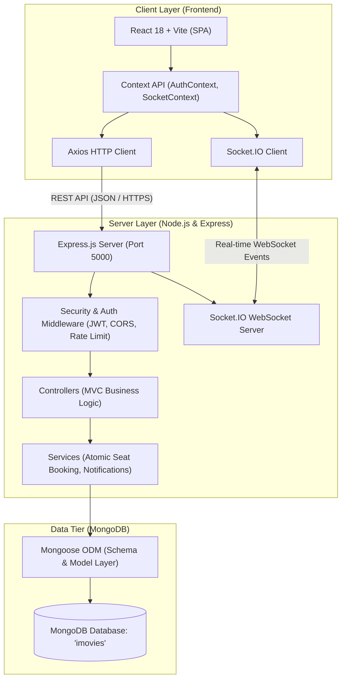

# Task 01: Technical Architecture

## 1. Overview
The **IMovies** web application is built on the modern **MERN (MongoDB, Express.js, React, Node.js)** full-stack architecture. The system separates responsibilities cleanly between the client interface, RESTful backend API layer, real-time event broadcasting, and persistent NoSQL document storage.

## 2. Layer Descriptions

### A. Client Tier (Frontend)
- **Framework**: React 18 with Vite for ultra-fast compilation and Hot Module Replacement (HMR).
- **Styling**: Bootstrap 5 with responsive grid design and custom cinema CSS variables.
- **State Management**: React Context API (`AuthContext` for session tokens and role state, `SocketContext` for live room subscriptions).
- **Client Networking**: Axios for Promise-based REST communication with request/response interceptors for automatic JWT injection and unified error catching.
- **Real-Time Client**: `socket.io-client` for listening to seat reservation updates from concurrent users.

### B. Application Tier (Backend)
- **Runtime**: Node.js (v20 LTS).
- **Web Framework**: Express.js (v4.21).
- **Architecture**: Model-View-Controller (MVC) separation of concerns.
- **Authentication**: Stateless JSON Web Tokens (JWT) signed with SHA-256 HMAC, stored securely in client storage and sent via `Authorization: Bearer <token>`.
- **Security**: `bcryptjs` (salt rounds: 10), `express-rate-limit` for DDoS/brute-force defense, strict CORS whitelisting.
- **Real-Time Engine**: Socket.IO for broadcasting seat state changes instantly to connected browsers in room `show_<showId>`.

### C. Database Tier (Storage)
- **Database Engine**: MongoDB (Local or MongoDB Atlas cloud cluster).
- **ODM**: Mongoose v8 with Schema validation, indexes, and atomic `$not: { $elemMatch: { ... } }` queries to guarantee race-condition-free seat bookings.
