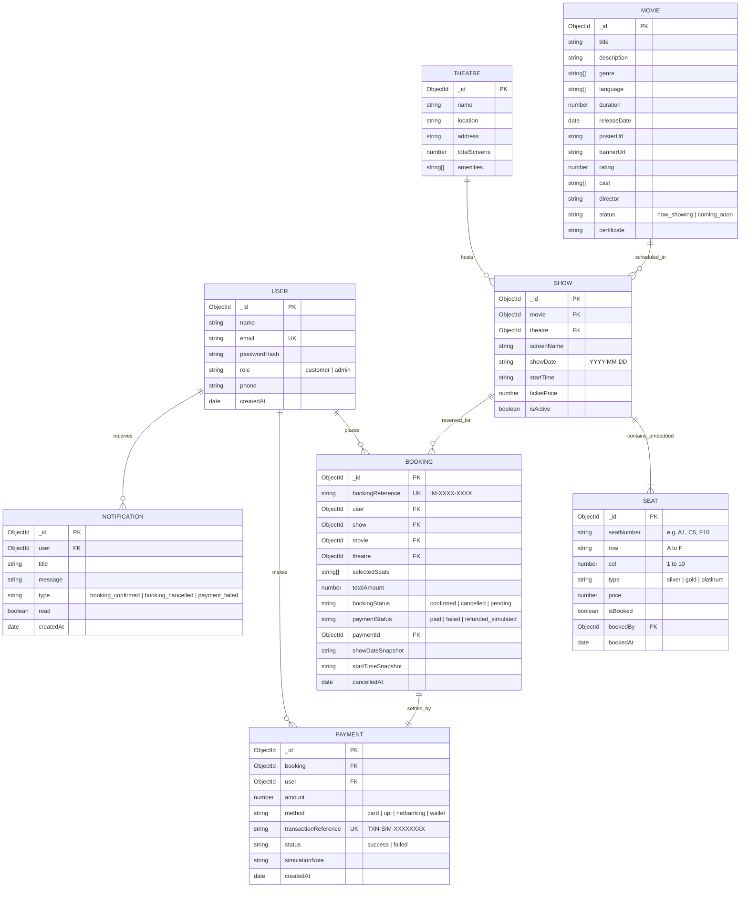

# Task 02: Entity-Relationship (ER) Diagram

## 1. Overview
The **IMovies** database schema is modeled in MongoDB using Mongoose. The data model utilizes normalized references for principal entities (Users, Movies, Theatres, Shows, Bookings, Payments) combined with embedded sub-documents for fine-grained entities (Show Seats layout) for single-query retrieval performance and atomic updates.

## 2. Key Relationship Explanations
1. **One-to-Many (`USER -> BOOKING`)**: A customer user can hold multiple movie bookings over time.
2. **One-to-Many (`MOVIE -> SHOW`)**: A movie can have multiple screenings across various multiplexes and time slots.
3. **Embedded Composition (`SHOW -> SEAT`)**: Each show contains an embedded array of 60 distinct seats (Rows A to F, Columns 1 to 10). This embedding allows atomic query-and-update checks when submitting a booking reservation.
4. **One-to-One (`BOOKING -> PAYMENT`)**: Every confirmed booking is linked to a simulated payment record storing the transaction reference.
5. **Auditing Snapshots (`showDateSnapshot`, `startTimeSnapshot`)**: Stored directly on `BOOKING` to preserve immutable ticket history even if the underlying show is archived.
