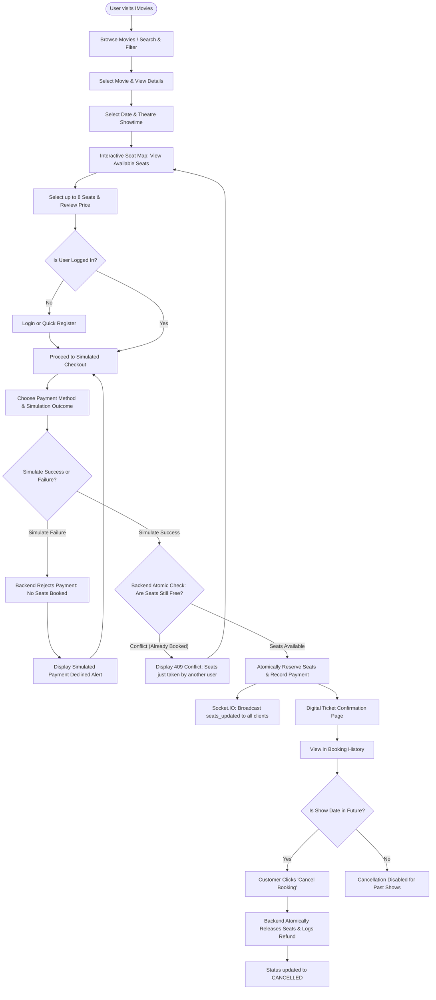

# Task 05: User Flow

## 1. End-to-End User Flow Diagram

## 2. Step-by-Step Flow Description
1. **Discovery**: Customer visits homepage, searches or filters movies by genre and language.
2. **Selection**: Customer clicks a movie to view detailed metadata and upcoming screening slots.
3. **Seat Mapping**: The customer selects a time slot to enter the real-time seat map. Seats are categorized by Silver, Gold, and Platinum.
4. **Authentication Check**: If the user is a guest, they are prompted to sign in with demo credentials or register.
5. **Simulated Payment**: Customer proceeds to the checkout screen and tests either a successful or failed simulated payment.
6. **Confirmation**: Upon successful payment, an atomic reservation is finalized, a digital ticket with unique reference is generated, and a real-time event updates all other viewing clients.
7. **Lifecycle Management**: Customer views tickets in "My Bookings" and can cancel future bookings to release seats back into the pool.
