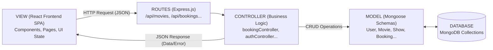

# Task 06: MVC Architecture Pattern

## 1. Overview
The **IMovies** project adheres to the **Model-View-Controller (MVC)** architectural pattern adapted for modern Single Page Applications (SPAs).

## 2. Component Separation

### A. Model (`server/src/models/`)
- Encapsulates database schema definitions, data types, validation constraints, and default values using Mongoose.
- Defines model-level helper methods:
  - `User.methods.comparePassword()` for bcrypt comparison.
  - `User.methods.toJSON()` for stripping sensitive hashes before sending to the client.
  - `User.statics.hashPassword()` for standardized password hashing.

### B. View (`client/src/`)
- In a decoupled MERN stack, the frontend client constitutes the View layer.
- Built using React functional components, hooks (`useState`, `useEffect`, `useContext`), and Bootstrap styling.
- Renders responsive interfaces and dispatches user actions as asynchronous HTTP requests to the controller endpoints.

### C. Controller (`server/src/controllers/`)
- Houses the application business logic.
- Validates request payloads and query parameters.
- Orchestrates interactions between models, calculates pricing multipliers, executes atomic database mutations, and generates simulated payment references.
- Coordinates external service events such as Socket.IO broadcast notifications.

### D. Router (`server/src/routes/`)
- Maps incoming HTTP request verbs (`GET`, `POST`, `PUT`, `DELETE`) and paths to corresponding controller functions.
- Mounts middleware chains such as `verifyToken`, `requireAdmin`, and `authLimiter` before executing controller actions.
